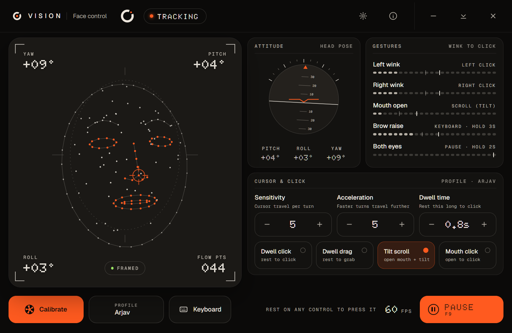
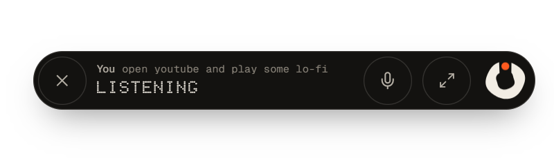

<p align="center">
  
</p>

<h1 align="center">VISION</h1>

<p align="center">
  Use your computer with your face and your voice. No hands needed.<br>
  <a href="https://github.com/arjavnotfound/vision/releases/latest">Download for Windows</a>
</p>

<p align="center">
  <a href="https://github.com/arjavnotfound/vision/actions/workflows/ci.yml"></a>
  <a href="https://github.com/arjavnotfound/vision/releases/latest"></a>
  <a href="LICENSE"></a>
</p>



VISION is a Windows app for people who cannot use, or do not want to use, a mouse and
keyboard. A webcam turns your head movement into cursor movement and your face gestures
into clicks. An optional voice assistant opens websites, types for you, switches windows
and changes VISION's own settings when you ask.

## Download and install

1. Download `VISION-Setup-<version>.exe` from the
   [latest release](https://github.com/arjavnotfound/vision/releases/latest).
2. Run it. It installs for your user only; no administrator rights are needed.
3. Open VISION from the Start menu or the desktop shortcut.

If Windows SmartScreen warns that the app is unrecognised, choose **More info**, then
**Run anyway**. Builds are not code-signed yet.

You need Windows 10 or 11 and a webcam. Face control works offline. The voice assistant
also needs a microphone and an internet connection.

## Face control

Look at the camera and calibrate once (VISION guides you through it). Then:

| To do this | Do this |
|---|---|
| Move the cursor | Turn your head |
| Left click | Wink your left eye |
| Right click | Wink your right eye |
| Click without gestures | Rest the cursor on something (dwell click) |
| Scroll | Open your mouth and tilt your head up or down |
| On-screen keyboard | Raise your eyebrows for 3 seconds |
| Pause or resume | Close your eyes for 2 seconds, or press F9 |

Every gesture can be moved to a different action, and every control in VISION can be
pressed by resting the cursor on it. If you touch the real mouse, VISION lets go of any
button it is holding and gives you control.

## Voice assistant



Rest on the orb at the bottom of the screen, or press **Ctrl+Alt+Space**, and talk:

- "Open YouTube and play some lo-fi"
- "Search for train times to Delhi"
- "Read this page to me"
- "Type: I will be there at five"
- "Switch to Word", "Close this window"
- "Make the cursor slower", "Pause face control", "Recalibrate"
- "Speak Hindi", "Detect my language", "Change your voice"

It understands English, Hindi and Hinglish, and answers in the language you speak (or
in a fixed language you choose in Settings). Before anything that could buy, send or
delete something, it asks you to confirm.

**Setup:** the assistant uses [LiveKit](https://livekit.io) for audio and Google's
[Gemini](https://aistudio.google.com) for understanding and speech. Create a free LiveKit
Cloud project and a Gemini API key, then enter them when VISION asks (Settings, Voice).
They are stored encrypted on your computer.

## Privacy

Camera frames never leave your computer and are never saved. Microphone audio goes
online only while the assistant is listening. There is no telemetry. Details, including
exactly what the assistant can send, are in [PRIVACY.md](PRIVACY.md).

## Building from source

You need Node.js 22, [pnpm](https://pnpm.io) 9 and [uv](https://docs.astral.sh/uv/).

```
npm run install-all     # installs app, core, console and agent dependencies
npm run build:console   # builds the assistant UI
npm start               # runs VISION from source
```

For voice in a source build, put your keys in `agent/.env.local` (see
`agent/.env.example`).

To build the installer (`release/VISION-Setup-<version>.exe`):

```
npm run dist
```

Tests: `npm test` (app and face tracking), `pnpm --dir console test`, and
`uv run --project agent pytest` (agent).

| Folder | What it is |
|---|---|
| `app/` | Electron app: windows, tray, input control, safety, agent supervisor |
| `core/` | Face tracking engine |
| `console/` | The assistant's orb, strip and console (Next.js, built to static files) |
| `agent/` | The voice agent (Python, LiveKit Agents, Gemini Live, Playwright) |
| `scripts/` | Build, benchmark and QA scripts |

Releases are built by GitHub Actions when a `v*` tag is pushed. Release notes are
generated automatically and are the [changelog](https://github.com/arjavnotfound/vision/releases).

## Recognition

1st prize, Event Expo 2026.

## Credits

Face Control started as a fork of [Tracky Mouse](https://github.com/1j01/tracky-mouse) (MIT)
and has since been substantially rewritten and extended.

VISION is built with Electron, MediaPipe Face Mesh, LiveKit, Google Gemini, Playwright,
Next.js and React. See [THIRD_PARTY_NOTICES.md](THIRD_PARTY_NOTICES.md) for the full list
and licenses.

## License

[MIT](LICENSE)
